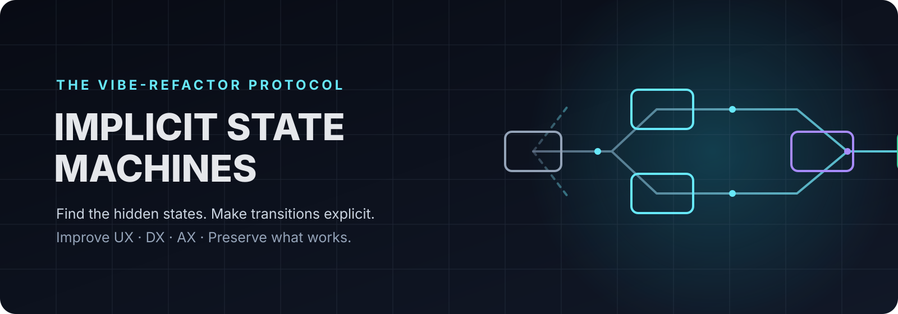

<div align="center">



# Implicit State Machines

### The Vibe-Refactor Protocol — hidden state, made explicit.

**Find the bugs hiding in boolean soup. Improve UX, DX and AX. Preserve what works.**

[](LICENSE)
[](https://agentskills.io/)
[](#the-skills)
[](#design-principles)

</div>

---

## Your app already has state machines. You just never wrote them down.

Vibecoders, open your messiest project. Look for the `isLoading`, `isSuccess`, `hasError`, and `isRetrying` flags that quietly describe one lifecycle. Add nested ternaries, scattered status strings, timers, retries, and asynchronous requests that can finish out of order. That is where impossible states and fragile behavior hide.

> **“Find all of the implicit state machines in my app. Make the best decision that elevates user experience (UX), developer experience (DX), and agent experience (AX), without breaking anything.”**

A one-line prompt can produce a one-shot answer. This repository turns the idea into a repeatable workflow: two portable `SKILL.md` agent skills, detection references, a safer before/after example, review checklists, and a consistent report format.

## The problem: boolean soup

```tsx
const [isLoading, setIsLoading] = useState(false);
const [isError, setIsError] = useState(false);
const [isSuccess, setIsSuccess] = useState(false);
const [user, setUser] = useState<User | null>(null);
```

Four independent values allow up to 16 combinations. A real workflow may need only a few. Which combinations are valid? What happens when an old request finishes after a retry? Does a reducer prevent the network request, or only ignore its event after the request has already started?

The skill makes these questions explicit before recommending a change.

## The skills

### 1. `implicit-state-machines`

**Repository-wide audit**

The deeper discovery and architecture workflow. It systematically hunts, ranks, and models hidden state machines across frontend, backend, mobile, data, and agent/tool lifecycles.

- Detect boolean clusters, scattered status strings, nullable state, refs-as-flags, timers, retry loops, and multi-step workflows.
- Record states, events, transitions, guards, effects, invariants, ownership, and lifetime.
- Rank findings by impact, evidence confidence, and change risk.
- Choose the lightest fit: union/enum, reducer, transition function, or statechart only when warranted.
- Characterize behavior, migrate one machine at a time, preserve compatibility, and verify honestly.

**Skill file:** [`skills/implicit-state-machines/SKILL.md`](skills/implicit-state-machines/SKILL.md)

### 2. `vibe-refactor-protocol`

**Code-first refactor**

The direct execution workflow based on the prompt you provided. Use it when you want an AI coding agent to diagnose a supplied snippet or feature and produce a focused refactor.

Its required response is:

1. **The Diagnosis** — the hidden lifecycle, concrete evidence, impossible combinations, and likely failures.
2. **The Refactored Code** — the complete relevant snippet or a focused repository patch.
3. **The UX / DX / AX Breakdown** — what became more predictable, maintainable, and understandable to future agents.
4. **Verification** — actual commands and results, unrun checks, assumptions, and residual risks.

**Skill file:** [`skills/vibe-refactor-protocol/SKILL.md`](skills/vibe-refactor-protocol/SKILL.md)

## Before and after

The example below uses one explicit state value instead of related booleans. It also tracks request identity: a reducer alone cannot stop an already-started asynchronous side effect or guarantee that the latest response wins.

```ts
type State =
  | { status: "idle" }
  | { status: "loading"; requestId: number }
  | { status: "error"; message: string }
  | { status: "ready"; user: User };
```

Full example, including stale-response handling and integration caveats: [`before-after.md`](skills/implicit-state-machines/examples/before-after.md).

## The Three-Lens Gate

| Lens | What it means | What improves |
|---|---|---|
| **UX — User experience** | What users see and feel | Predictable loading, success, error, retry, and cancellation; fewer contradictory or stuck states. |
| **DX — Developer experience** | What developers read and maintain | One clear source of truth, semantic transitions, less scattered state logic, and focused tests. |
| **AX — Agent experience** | What AI coding agents can understand and safely change | Discoverable states/events, explicit invariants, exhaustive handling, deterministic tests, and local documentation. |

AX means **agent experience** in this project. Accessibility remains part of UX and is not replaced by the AX lens.

## The “preserve what works” contract

The last part of the prompt is the hard part. These skills therefore require:

- Discovery, ranking, and modeling before editing.
- Characterization tests for consequential existing behavior.
- One lifecycle per focused change.
- Compatibility adapters while legacy callers remain.
- No invented states or unapproved API, persistence, schema, or event-contract changes.
- Explicit treatment of stale async results, duplicate work, cancellation, and cleanup.
- Honest verification: no claim of zero regressions and no claim that checks passed unless they were run.

## Install

### With a skills installer

Where your AI tool supports the skills CLI:

```bash
npx skills add YOUR_GITHUB_USERNAME/implicit-state-machines
```

Replace `YOUR_GITHUB_USERNAME` with the GitHub owner. Check the installer documentation for its current supported agents and flags.

### Manual installation

Copy one or both skill directories into a skills directory recognized by your agent:

```text
skills/implicit-state-machines/
skills/vibe-refactor-protocol/
```

Common project-local conventions include `.agents/skills/`, `.claude/skills/`, `.cursor/skills/`, and `.github/skills/`. The exact install location and discovery behavior are tool-specific; consult the target agent's current documentation.

More detail: [`docs/installation.md`](docs/installation.md).

## Use it

**Full application audit**

```text
Find all of the implicit state machines in my app. Rank the important ones.
Model the worst offenders and recommend the smallest safe improvements across UX, DX and AX.
Do not edit code until I approve the plan.
```

**Execute the Vibe-Refactor Protocol**

```text
Use the vibe-refactor-protocol skill on src/checkout.
Diagnose first, then safely refactor the highest-impact lifecycle.
Preserve existing interfaces and report UX/DX/AX gains and verification.
```

**Investigate a specific bug**

```text
The checkout sometimes submits twice and occasionally shows an old error after retry.
Trace the lifecycle, identify the race or impossible state, and fix only the confirmed cause.
```

You can also copy the standalone prompt from [`prompts/vibe-refactor-protocol.md`](prompts/vibe-refactor-protocol.md).

## Repository layout

```text
implicit-state-machines/
├── README.md
├── LICENSE
├── assets/
│   └── implicit-state-machines-banner.svg
├── docs/
│   ├── audit-checklist.md
│   ├── installation.md
│   └── report-template.md
├── prompts/
│   └── vibe-refactor-protocol.md
├── scripts/
│   └── validate_skills.py
├── skills/
│   ├── implicit-state-machines/
│   │   ├── SKILL.md
│   │   ├── examples/
│   │   │   ├── before-after.md
│   │   │   └── sample-audit.md
│   │   └── references/
│   │       ├── audit-checklist.md
│   │       ├── detection-signals.md
│   │       └── report-template.md
│   └── vibe-refactor-protocol/
│       └── SKILL.md
└── .github/workflows/validate.yml
```

## Design principles

- **Portable format:** ordinary YAML frontmatter and Markdown instructions; no proprietary runtime or tool-specific syntax inside the skills.
- **No forced framework:** no XState requirement and no runtime dependency.
- **Stack-aware:** follow the project's current language, framework, and state-management conventions.
- **Evidence first:** findings cite files and symbols; suspicions are labelled as such.
- **Small diffs:** preserve existing contracts and avoid broad rewrites.

The format is intended for agents that support the Agent Skills-style `SKILL.md` convention. A shared file format does not mean every AI tool auto-discovers skills in the same location or implements every capability identically.

## Contributing

Useful contributions include new detection signals, tested examples for additional stacks, edge cases involving asynchronous work, and improvements to the audit/report templates. Keep examples self-contained and label fictional data clearly.

See [`CONTRIBUTING.md`](CONTRIBUTING.md).

## Credits and attribution

This repository is an independent implementation inspired by the widely shared prompt about finding implicit state machines and improving UX, DX, and AX without breaking behavior. The original prompt's author should be credited by anyone who republishes the prompt itself; this repository's skills, workflows, documentation, and examples are maintained as an MIT-licensed project.

## License

MIT — see [`LICENSE`](LICENSE).

---

<div align="center">

**If this workflow helped you find a real bug or make a safer refactor, consider starring the repository and sharing what it caught.**

</div>
