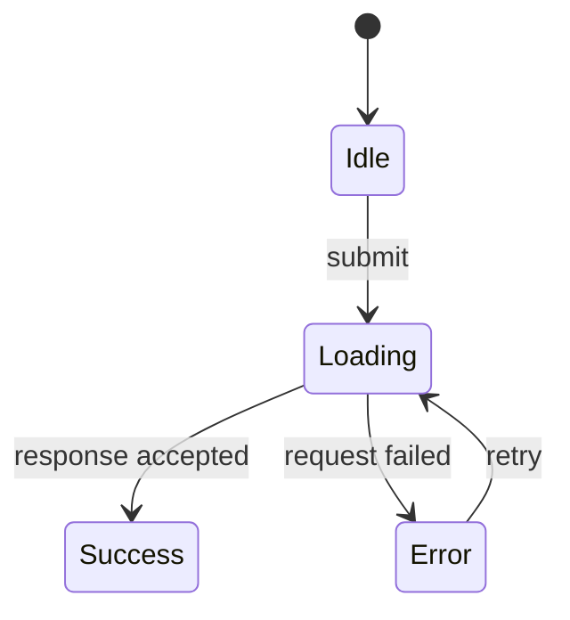

# Implicit State Machines Report — [project / feature]

**Scope:** [application / feature / workflow]  
**Mode:** [audit-only / audit + implementation]  
**Date:** [YYYY-MM-DD]

## 1. Executive readout

[Summarize the state architecture, the most important risk, and the recommended decision.]

## 2. State-machine inventory

| Workflow | Owner / evidence | States and events | Confidence | Notes |
|---|---|---|---|---|
| [Workflow] | `[path:line]` | [states; important events] | [High/Medium/Low] | [notes] |

## 3. Transition model

Replace this illustrative diagram with transitions supported by the target code.

## 4. Findings

| ID | Severity | Confidence | Evidence | Failure mode | UX impact | DX impact | AX impact | Change risk |
|---|---|---|---|---|---|---|---|---|
| F-01 | [Critical/High/Medium/Low] | [High/Medium/Low] | `[path:line]` | [what could happen] | [impact] | [impact] | [impact] | [Low/Medium/High] |

## 5. Recommended decision

- **Change:** [smallest justified intervention]
- **Keep:** [sound behavior or architecture to preserve]
- **Why:** [evidence and trade-offs]
- **Validation needed:** [tests or runtime confirmation]

## 6. Implementation summary

[Only include when code was changed. List files, behavior changed, and compatibility considerations.]

## 7. Verification

| Check | Command | Result |
|---|---|---|
| Tests | `[command]` | [Passed / Failed / Not run] |
| Lint | `[command]` | [Passed / Failed / Not run] |
| Type-check | `[command]` | [Passed / Failed / Not run] |
| Build | `[command]` | [Passed / Failed / Not run] |

**Pre-existing failures:** [list or none observed]  
**Not verified:** [items]  
**Residual risks:** [items]  
**Open questions:** [items]
