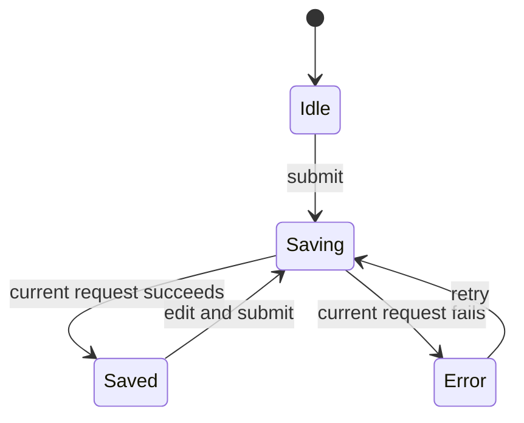

# Sample audit (fictional example)

> Illustrative data for learning the report format. This is not evidence about a real repository.

## Executive readout

A fictional account settings page has one high-priority implicit lifecycle: profile saving. Three related booleans and a nullable error can represent contradictory UI states. The smallest proposed change is a typed save status with request identity, while keeping the existing `onSaved` prop unchanged.

## Inventory

| Workflow | Owner | Candidate states | Confidence |
|---|---|---|---|
| Profile save | `ProfileEditor` | idle, saving, saved, error | High |
| Avatar preview | `AvatarPicker` | closed/open | High; independent toggle, leave as-is |

## Transition model

## Finding F-01

- **Severity:** High
- **Confidence:** High
- **Evidence:** fictional `ProfileEditor.tsx` writes `isSaving`, `hasSaved`, and `saveError` in the same submit handler.
- **Failure mode:** a previous error can remain visible after a successful retry.
- **UX:** conflicting save feedback.
- **DX:** lifecycle behavior is spread across three setters.
- **AX:** an agent must infer allowed combinations from multiple branches.
- **Change risk:** Medium; save behavior is user-visible and should be characterized first.

## Decision

Add tests for initial save, success, failure, retry, and stale responses. If they confirm the inferred contract, replace the related flags with a discriminated union, retain the public `onSaved` contract, and derive any legacy read-only flags during migration.

## Verification

No commands were run. This sample intentionally makes no claim that code or tests pass.
